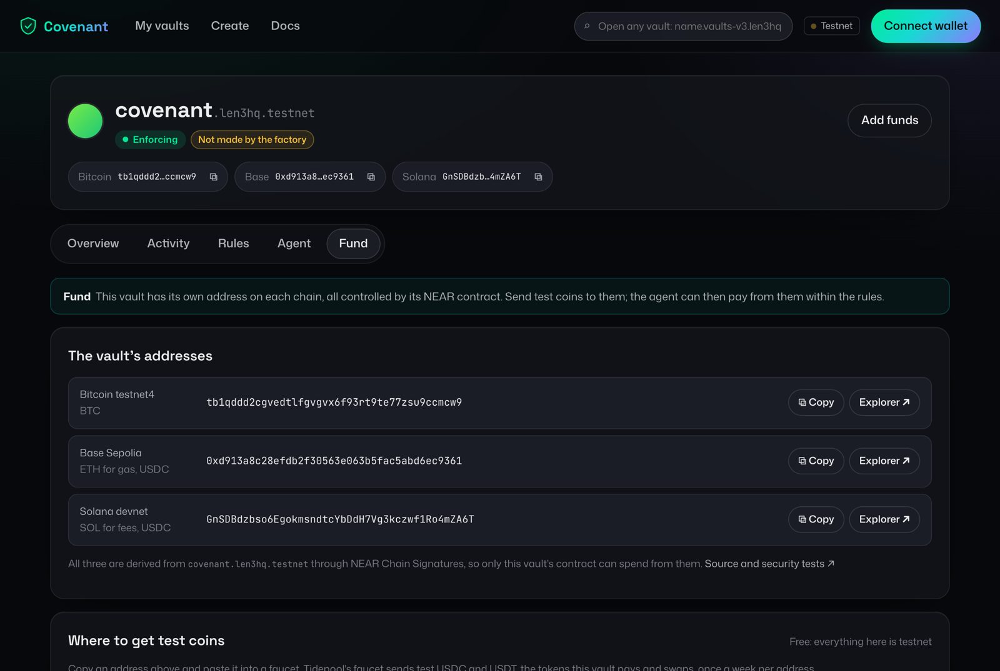
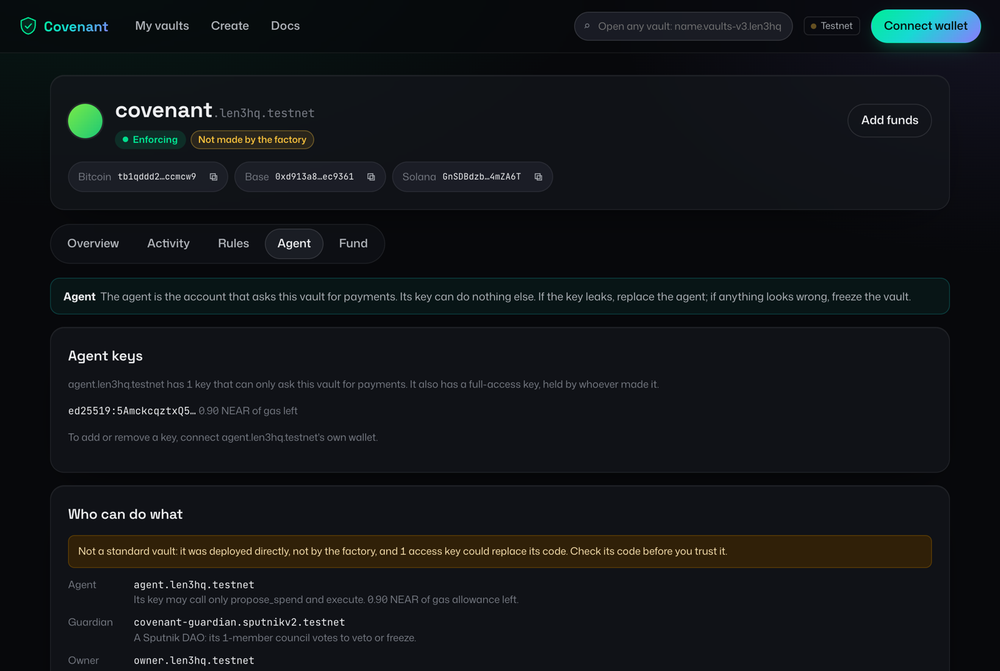

# NEAR features used

Covenant uses NEAR as the one place where an AI agent's spending is decided, on chains NEAR doesn't
run. Each row links to the code that uses the feature. The live transactions are in
[EVIDENCE.md](EVIDENCE.md).

## Chain Signatures

The vault controls a Bitcoin address and an EVM address without any private key existing for them.
NEAR's MPC network signs for the contract's account, so only the contract's code decides what gets
signed.

| What | Where |
| --- | --- |
| The contract asks the MPC signer for one signature per hash, attaching 1 yoctoNEAR and the `secp256k1` domain | [lib.rs:524-532](contracts/covenant-vault/src/lib.rs#L524-L532) |
| The signatures are joined with `Promise::and`, then checked in one callback | [lib.rs:536-538](contracts/covenant-vault/src/lib.rs#L536-L538) |
| The callback reads each result, and keeps the reservation if a freeze landed meanwhile | [lib.rs:285](contracts/covenant-vault/src/lib.rs#L285) |
| The vault's addresses come from `derived_public_key`, for the contract account and its paths | [vault-keys.ts:7-11](scripts/src/vault-keys.ts#L7-L11) |
| Solana spends are signed in the Ed25519 domain, over the exact message the contract checked | [lib.rs](contracts/covenant-vault/src/lib.rs), `sign_all` |
| The factory derives each vault's Solana address from `derived_public_key` with `domain_id` 1 | [covenant-factory](contracts/covenant-factory/src/lib.rs), `create_vault` |
| The hashes it signs are computed in the contract: BIP143 for Bitcoin, keccak256 for EVM | [bitcoin/lib.rs:166](contracts/adapters/bitcoin/src/lib.rs#L166), [evm/lib.rs:177](contracts/adapters/evm/src/lib.rs#L177) |
| NEAR's host functions do the hashing, with no C dependency in the contract | [bitcoin/lib.rs:105-109](contracts/adapters/bitcoin/src/lib.rs#L105-L109) |

The dashboard's **Fund** tab shows the three addresses, all derived from the vault's NEAR account:

## Access keys

| What | Where |
| --- | --- |
| The agent holds a function-call key that can call only `propose_spend` and `execute` on the vault, with a 1 NEAR gas allowance | [create-agent-key.ts:25](scripts/src/create-agent-key.ts#L25) |
| A sandbox test proves that key can't reach owner methods, move NEAR, attach a deposit or call another contract | [access_control.rs:117](tests/integration/tests/access_control.rs#L117) |
| The vault's full-access key is removed before submission, so its code can't be replaced | Planned for 13 Nov, see [SECURITY.md](SECURITY.md) |

## Contract design

| What | Where |
| --- | --- |
| One entry point for every spend: parse, check the policy, then sign or queue | [lib.rs:220](contracts/covenant-vault/src/lib.rs#L220) |
| `#[private]` callback, so only the vault can settle its own signing | [lib.rs:271-273](contracts/covenant-vault/src/lib.rs#L271-L273) |
| A rolling 24-hour ledger with reservations, in a `LookupMap`, and the veto queue in an `IterableMap` | [lib.rs:212-213](contracts/covenant-vault/src/lib.rs#L212-L213), [lib.rs:553-564](contracts/covenant-vault/src/lib.rs#L553-L564) |
| `execute` and `veto`, with today's policy re-checked at execution | [lib.rs:316](contracts/covenant-vault/src/lib.rs#L316), [lib.rs:361](contracts/covenant-vault/src/lib.rs#L361) |
| NEP-297 events for every spend, refusal, veto and freeze, which the dashboard reads | [lib.rs:131](contracts/covenant-vault/src/lib.rs#L131) |

## Global contracts and the factory

| What | Where |
| --- | --- |
| Every vault runs one published copy of the code, by hash, so a vault stores about 700 bytes instead of 265 KB | [covenant-factory/src/lib.rs](contracts/covenant-factory/src/lib.rs) (`use_global_contract`) |
| One batch creates the account, funds it, sets its code and initializes it, so none can happen alone | [covenant-factory/src/lib.rs](contracts/covenant-factory/src/lib.rs) (`on_keys`) |
| Addresses derived on-chain through a cross-contract call to the signer's `derived_public_key` | [covenant-factory/src/lib.rs](contracts/covenant-factory/src/lib.rs) (`derive_key`) |
| A vault with no access keys, so its code can't be replaced by anyone | `factory_vault_has_no_keys_and_runs_the_shared_code` |

## Sputnik DAO

The guardian is a Sputnik DAO created with the `sputnikv2.testnet` factory. A council member proposes
a call to the vault and votes it through; a live veto took 23 seconds.

| What | Where |
| --- | --- |
| The owner can swap the guardian for a DAO | [lib.rs:403](contracts/covenant-vault/src/lib.rs#L403) |
| `make dao-veto` and `make dao-freeze` propose, then vote for the proposal they made | [dao.ts:39-55](scripts/src/dao.ts#L39-L55) |
| The dashboard does the same through a council member's wallet, voting for the proposal it finds by its own description | [wallet.ts:115](web/src/wallet.ts#L115) |

## Tooling and infrastructure

| What | Where |
| --- | --- |
| `near-workspaces` sandbox tests deploy the real wasm with a mock signer | [common/mod.rs:155](tests/integration/tests/common/mod.rs#L155) |
| The keyless demo runs the same contract on a local sandbox | [sandbox.rs:32](tests/integration/examples/sandbox.rs#L32), [sandbox.ts:28](agent/src/sandbox.ts#L28) |
| The agent signs its NEAR transaction locally, so a timeout is looked up by hash, never resent | [sdk/src/vault.ts:165-189](sdk/src/vault.ts#L165-L189) |
| NEAR Connect for wallet sign-in and signing in the dashboard | [wallet.ts:81](web/src/wallet.ts#L81) |
| FastNEAR's RPC and transaction API, which the dashboard reads events from | [vault.ts:315](web/src/vault.ts#L315) |
