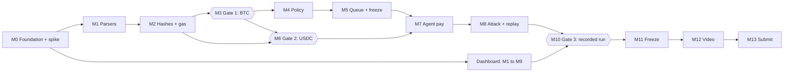

# Covenant build plan: 0 to 100

This is the plan we follow from an empty repo to a submitted entry by **20:00 UTC on Sat 14 Nov 2026**. Work through milestones M0 to M13 in order of date, and tick boxes as you finish them. [SPEC.md](SPEC.md) holds the detail behind each task.

**Where we are on 5 Nov: 64%.** M0 to M6 have passed their exit checks, with M5 a day early and M6 two days early. All remaining gates keep their dates. D5, D6, D10 and D11 were decided on 5 Nov.

## How to use this plan

- **Progress only counts at exit checks.** A milestone's percentage is earned when its exit check passes, not when its tasks look nearly finished.
- **Each task has one owner.** Role labels are from the spec: **Lead** (contract + Bitcoin), **B** (EVM + agent), **C** (dashboard + tests + evidence), **D** (optional: docs + video).
- **Each day ends with a check.** At the daily 15-minute standup, the lead reads yesterday's exit check, today's exit check and any blockers.
- **A missed gate triggers its fallback that same evening.** Fallbacks are in [If we fall behind](#if-we-fall-behind).
- **Update this file in the same commit as the work.** Tick the box, and add the proof link where a task asks for one.

## The road to 100%

| Milestone | Progress | Due | Owner | Exit check |
| --- | --- | --- | --- | --- |
| M0 Foundation and signing spike | 10% | Tue 3 Nov (was 2 Nov) | All | CI green; one real MPC signature; both vault addresses funded |
| M1 Parsers | 18% | Tue 3 Nov | Lead, B | Parser rejection tests pass on both chains |
| M2 Signing hashes and gas numbers | 26% | Tue 3 Nov | Lead, B | Hashes match all vectors; `btc_max_inputs` set from a measurement |
| **M3 Gate 1: Bitcoin signed by the contract** | 36% | **Wed 4 Nov** | Lead | Confirmed testnet4 txid in EVIDENCE.md |
| M4 Policy engine | 46% | Thu 5 Nov | Lead | Every policy rule has a named passing test |
| M5 Queue, veto, freeze | 54% | Fri 6 Nov | Lead | Integration suite green |
| **M6 Gate 2: USDC signed by the contract** | 64% | **Sat 7 Nov** | B | Confirmed Base Sepolia USDC tx in EVIDENCE.md |
| M7 Agent pays on both chains | 72% | Sun 8 Nov | B | `pay` scenario works end to end |
| M8 Attack, queue and replay | 79% | Mon 9 Nov | B, C | All 3 scenarios pass in replay mode |
| M9 Dashboard live, bug bash | 85% | Tue 10 Nov | C, All | Dashboard at a public URL |
| **M10 Gate 3: full recorded run** | 91% | **Wed 11 Nov** | All | EVIDENCE.md complete; 40+ named tests pass |
| M11 Feature freeze | 94% | Thu 12 Nov | All | `main` tagged `rc1` |
| M12 Video and fresh-clone test | 98% | Fri 13 Nov | D or C | Video exported; fresh clone passes |
| M13 Submit | 100% | **Sat 14 Nov** | Lead | Confirmation screenshot saved |

### What depends on what

The Lead and B work in parallel from M1, and C's dashboard runs alongside both. The sign call built for gate 1 is shared with EVM, so gate 2 depends on it.

## Decisions we need

These block work, so settle them at today's standup. Each has a recommended answer.

| # | Decision | Recommendation | Owner | By |
| --- | --- | --- | --- | --- |
| D1 | ~~Who fills each role?~~ | Resolved for now: Frank runs everything alone, so every role label in this plan means Frank. Revisit if anyone joins. | Lead | Done |
| D2 | ~~Was the pre-1 Nov signing spike run?~~ | Resolved: run on 3 Nov and passed. See [SPIKE.md](SPIKE.md). | Lead | Done |
| D3 | The repo is private, but the spec needs a public repo. | Renamed to `Len3hq/covenant` on 3 Nov. Go public by M11 at the latest, after a gitleaks run. | Lead | 12 Nov (public) |
| D4 | ~~Final vault account name~~ | Resolved: `covenant.len3hq.testnet`, confirmed on 3 Nov. Don't rename it, because the vault addresses derive from it (see C7). | Lead | Done |
| D5 | How judges run `make demo` without our keys (see C8) | Checked on 5 Nov: the form has no private field, and Claude Code and Codex screen each project by running it against the README. Decided on 5 Nov: `make demo` runs the real contract in the sandbox with the mock signer, labelled as such, and needs no keys. Live evidence is linked beside it. A `--live` mode uses the real signer for anyone holding a key. | Lead | Done |
| D6 | Keep or remove the contract's full-access key? | Decided on 5 Nov: keep it through the build, and remove it on 13 Nov after the fresh-clone test, not before the 11 Nov run, so a late bug can still be fixed. Removal can't be undone, so confirm once more on the day. Say so in SECURITY.md. | Lead | Done |
| D7 | LLM provider | NEAR AI Cloud if its API works by 8 Nov. Otherwise any tool-calling model behind `LLM_BASE_URL`. | B | 8 Nov |
| D8 | Prize split and payout wallet | Prizes are paid in NEAR to the wallet on the form, so use a mainnet account. | Lead | 12 Nov |
| D10 | Which of the 13 tracks to enter | Decided on 5 Nov: AI Security & Defense, plus Agent Economy. | Lead | Done |
| D11 | How the real Sputnik DAO guardian works | Done on 5 Nov: `covenant-guardian.sputnikv2.testnet` is the live guardian, with one council member. A DAO veto took 23 s, inside the 120 s window, so the demo can use it. | Lead | Done |
| D9 | ~~Cut the real Sputnik DAO guardian and dashboard policy editing up front, since Frank works alone?~~ | Resolved on 3 Nov: no. Both stay in scope. | Lead | Done |

## Spec corrections

Setup and review turned up these problems in [SPEC.md](SPEC.md). **This list wins where the two disagree.** Each one is either a bug someone would otherwise build or a claim that wouldn't hold up with judges.

### Fix in the contract

| # | Problem in the spec | What to do | Milestone |
| --- | --- | --- | --- |
| C1 | Bitcoin rule 2 says to byte-reverse the double-SHA256 and compare it with the outpoint. A serialized outpoint already uses the same internal byte order as the raw hash, so reversing rejects every valid input. | Compare the raw hash with the outpoint directly. Reverse only for display and explorer URLs. | M1 |
| C2 | The agent fetches prev txs from `/tx/{txid}/hex`, which returns witness data for SegWit transactions. A txid hashes the non-witness form, so those would fail with `PrevTxMismatch`. Faucet funding is usually SegWit. | The agent strips witness data before calling. The contract refuses witness-serialized prev txs. Add `btc_rejects_witness_prev_tx`. | M1, M7 |
| C3 | The spec calls `sign` with `key_type`. The [MPC contract docs](https://github.com/near/mpc/blob/main/crates/contract/README.md) use a `domain_id` instead. | Use the request shape in [Verified facts](#verified-facts). | M3 |
| C4 | Bitcoin fees don't count against any cap, so an agent could burn vault funds through repeated high-fee or self-spend transactions, each one within the fee rate limit. | Charge `payments + fee` to the asset's caps on both chains. An EVM USDC spend then needs an `EvmNative` cap too, so include one in the demo policy. Add `btc_fee_counts_against_daily_cap`. | M4 |
| C5 | `per_tx` and `queue_at` read as checks on each payment. Splitting one spend across up to 8 outputs would get under both limits. | Sum payments per asset in the transaction before checking. Add `btc_split_outputs_cannot_dodge_per_tx_cap`. | M4 |
| C6 | Ledger entries are pruned after 24 h, but a queued spend reserves budget at proposal time. With the real 24 h veto delay, the reservation can expire before `execute`, and the cap can be exceeded. | At `execute`, replace the old entry with a new one stamped at signing time, and re-check the cap without counting its own old reservation. Add `execute_after_long_delay_respects_daily_cap`. | M5 |

Those additions are in the [test tracker](#named-test-tracker). They also give the 40-test target some slack, since the spec's minimum list is exactly 40.

### Fix in the docs and demo

| # | Problem in the spec | What to do | Milestone |
| --- | --- | --- | --- |
| C7 | Nothing warns that a vault address depends on the account name and path. Changing either one strands any funds sent to the old address. | Settle D4 before funding. Redeploying to the same account keeps the addresses. | M0 |
| C8 | `.env.example` is defined as "never real keys" and also as holding a demo key, and keys are rotated on 14 Nov, before judging on 16 to 18 Nov. | Commit no key. Decide the judge path in D5. Keep the demo key valid until judging ends, and rotate it afterwards. | M0, M13 |
| C9 | `make demo` must finish in under 5 minutes, but a testnet4 confirmation can take far longer. | `demo-pay` finishes when the node accepts the broadcast, and prints the explorer link. Confirmed txids live in EVIDENCE.md. | M7 |
| C10 | Judges share the rolling 24 h caps, the funds and the agent key's 1 NEAR allowance, so a few runs could leave the next judge with `DailyCapExceeded`. | Size caps and funding for at least 10 full demo runs, measure real allowance use, and top up during judging. Keep the recorded run as a fallback. | M8 |
| C11 | "Freeze blocks pending callbacks" overstates it. An MPC signature is public on-chain once produced, and blocking our callback can't take it back. | Freeze stops new `sign` calls. SECURITY.md must state that signatures already requested can still land, and that a partly failed join still publishes its successful signatures ([spike](SPIKE.md)). Keep the reservation when a callback runs during a freeze. | M5, M8 |
| C12 | The scope says the agent key only calls `propose_spend`, while the key spec also allows `execute`. | The key spec is right. Use "`propose_spend` and `execute`" everywhere. | M6 |
| C13 | Queue entries are specified as "raw tx ≤ 2 KB", but `execute` also needs each input's amounts, which come from prev txs that could be far larger. | Store the parsed payments, fee and signing hashes in `Pending`, and re-check those. Don't store prev txs. The current `Pending` struct is a placeholder. | M5 |
| C14 | The Makefile list has no `demo` target, though the done-check runs `make demo`. | Added. It runs all three scenarios. | Done |
| C15 | `ChangeNotToVault` can't fire under Bitcoin rule 3. Nothing in a transaction marks an output as change, so change sent to a foreign script is just an unlisted output. | That case returns `OutputNotWhitelisted`, and `btc_rejects_change_to_foreign_script` asserts it. Say so in the README and video. The variant stays unused. | Done |

### Already changed in the scaffold

| Spec says | Scaffold does | Why |
| --- | --- | --- |
| Amounts as `u128` | `U128` wherever amounts cross JSON | JS loses precision above 2^53 |
| `btc_pubkey: [u8; 33]` in `new` | `Base64VecU8`, validated to 33 compressed bytes | serde arrays stop at 32 elements |
| Node 20 | Node 22 | Node 20 reached end of life in April 2026 |
| `policy` crate is no_std-friendly | Depends on `near-sdk` for serialization only | Keeps ABI generation simple; the logic stays pure |
| Solana crate in the layout | README only, not a workspace member | Stretch work starts after gate 3 |

### Verified facts

Checked on 2 Nov 2026. Use these instead of the matching "verify" notes in the spec.

| Fact | Result | How |
| --- | --- | --- |
| Testnet MPC contract | `v1.signer-prod.testnet`, version 3.18.0, responding | Live view call |
| Deriving vault keys | `derived_public_key(path, predecessor, domain_id)` exists | Live view call |
| `sign` arguments | `{"request": {"payload_v2": {"Ecdsa": "<32-byte hex>"}, "path": "...", "domain_id": 0}}` | [MPC docs](https://github.com/near/mpc/blob/main/crates/contract/README.md) |
| `sign` deposit and gas | At least 1 yoctoNEAR, with excess refunded. **The live contract requires 15 Tgas, not the 10 its docs state.** Attach 30 Tgas. | MPC docs, [spike](SPIKE.md) |
| Contract-initiated signing | Works, up to 8 signatures joined with `Promise::and`, in about 5 to 15 s; every signature verified against the derived key | [Spike](SPIKE.md) |
| Failed `sign` | The callback still runs and sees the failure. One failure doesn't stop the other signatures in the join. | [Spike](SPIKE.md) |
| `domain_id` | 0 is secp256k1 (Bitcoin and EVM), 1 is Ed25519 | Live `state` view, [spike](SPIKE.md) |
| Signature format | `s` is already low-s; `r` is bytes 1 to 33 of compressed `big_r` | MPC docs |
| Solana payload size | Eddsa accepts 32 to 1232 bytes, so the spec's 32-byte worry doesn't apply | MPC docs |
| Base Sepolia USDC | `0x036CbD53842c5426634e7929541eC2318f3dCF7e` returns symbol `USDC`, 6 decimals | Live `eth_call` |
| Testnet4 API | Responding; tip at height 158613; all fee rates 1 sat/vB | Live request |
| Toolchain | Rust 1.99.0, near-sdk 5.30.0 and cargo-near 0.22.0 build a 208 KB wasm that deploys and runs in the sandbox | `vault_deploys_and_answers_views` |
| Hash host functions | `env::sha256`, `env::keccak256` and `env::ripemd160_array` are available | near-sdk source |

**Still unproven:** broadcasting a transaction signed this way (gates 1 and 2). The strategy document and the 1,735-character description that the spec mentions weren't available during setup, so M12 and M13 assume the Lead has them.

## Milestones

### M0: Foundation and signing spike (to 10%), Mon 2 Nov

*Goal: prove the riskiest assumption before building on it.*

**Done in setup**

- [x] Monorepo: Rust workspace, pnpm workspace, Makefile, `.env.example`
- [x] Core types and the full `CovenantError` enum in `contracts/policy`
- [x] Vault skeleton with state, `new`, views, `freeze`, `unfreeze` and `set_policy`; unimplemented spend methods fail closed
- [x] Sandbox harness with one deploy test
- [x] Agent CLI and dashboard skeletons, each with tests
- [x] CI workflow for Rust, wasm, TypeScript and gitleaks
- [x] AGENTS.md and doc stubs

**Done on 3 Nov**

- [x] Testnet accounts under `len3hq.testnet`: `covenant`, `owner`, `agent`, `guardian`, `spike`
- [x] Spike: real contract-initiated signatures, and `Promise::and` over up to 8 `sign` calls with a callback ([SPIKE.md](SPIKE.md))
- [x] `make addresses`: `derived_public_key` to a testnet4 bech32 address and an EVM address, tested against known vectors
- [x] `make deploy`, with the skeleton deployed to `covenant.len3hq.testnet`
- [x] Vault funded with 4 NEAR
- [x] Mock signer in `tests/mock-signer`, using the live `sign` shape and failing on demand
- [x] `MpcSignature` matches the live response shape

**Still to do**

- [x] **Lead:** settle D4
- [x] **Lead:** rename the repo (D3); going public is still due by M11
- [ ] **Lead:** share the keys in `~/.near-credentials` through the team's password manager; they exist on one machine only
- [x] **Lead:** fund the vault addresses below (testnet4 BTC, Base Sepolia ETH, Circle faucet USDC). These faucets need a person

| Address | Value | Needs |
| --- | --- | --- |
| Bitcoin testnet4 | `tb1qddd2cgvedtlfgvgvx6f93rt9te77zsu9ccmcw9` | About 1,000,000 sats |
| Base Sepolia | `0xd913a8c28efdb2f30563e063b5fac5abd6ec9361` | About 0.05 ETH and 20 USDC |

Funded on 3 Nov: 759,051 sats, all confirmed; 20 USDC; 0.0001 ETH, which needs a top-up before the M10 recorded run.

**Exit check:** CI green on `main`; one real MPC signature recorded in `docs/SPIKE.md`; both funded addresses visible in explorers.

### M1: Parsers (to 18%), Tue 3 Nov

*Goal: raw bytes in, typed payments or a named error out.*

- [x] **Lead:** `contracts/adapters/bitcoin`: non-witness parser following spec rules 1 to 5, with C1 and C2 applied
- [x] **Lead:** tests `btc_accepts_whitelisted_payment_with_change`, `btc_rejects_unlisted_output`, `btc_rejects_change_to_foreign_script`, `btc_rejects_fee_rate_above_cap`, `btc_rejects_prev_tx_mismatch`, `btc_rejects_input_not_owned`, `btc_rejects_witness_serialization`, `btc_rejects_witness_prev_tx`, `btc_rejects_too_many_inputs`, `btc_rejects_op_return`
- [x] **B:** `contracts/adapters/evm`: type-2 RLP decoder and both transaction shapes, no `alloy` or `ethers` dependency in the contract
- [x] **B:** tests `evm_accepts_native_transfer_to_payee`, `evm_accepts_usdc_transfer_to_payee`, `evm_rejects_approve`, `evm_rejects_transfer_from`, `evm_rejects_arbitrary_calldata`, `evm_rejects_legacy_type0`, `evm_rejects_wrong_chain_id`, `evm_rejects_gas_cost_above_cap`, `evm_rejects_value_with_token_call`, `evm_rejects_unlisted_token`, `evm_rejects_unlisted_payee`
- [x] **C:** dashboard reads contract views: frozen state, addresses, policy
- [x] **C:** tests `non_agent_cannot_propose`, plus real access-control sandbox tests for owner methods

Both parsers also pass mutation spot-checks, and `btc_accepts_a_real_testnet4_funding_tx` runs on real chain data. `signing_hashes` stays empty until M2, and `propose_spend` still fails closed until M3.

**Exit check:** every test above passes in CI.

### M2: Signing hashes and gas numbers (to 26%), Tue 3 Nov

*Goal: our hashes match the outside world, and we know what fits in 300 Tgas.*

- [x] **Lead:** BIP143 sighash per input
- [x] **Lead:** `btc_sighash_matches_bip143_vectors`: the official BIP143 P2WPKH example plus 4 from bitcoinjs, stored in `tests/vectors/`
- [x] **B:** `keccak256(0x02 ‖ rlp(fields))`, with `evm_hash_matches_viem` (5 vectors in `tests/vectors/`)
- [x] **Lead:** measure gas for 1, 2 and 3 inputs plus the wasm size. Set `btc_max_inputs` from the result, and record the numbers in the README

`btc_max_inputs` stays at 3: it needs at most 116.4 of the 300 Tgas limit, and 8 inputs would still fit today, but with little room for the M4 and M5 checks. Vectors come from `pnpm --filter @covenant/scripts vectors`.

**Exit check:** all vectors match; gas table in the README; `btc_max_inputs` chosen from a measurement.

### M3: Gate 1, Bitcoin signed by the contract (to 36%), Wed 4 Nov

*Goal: the core claim works once, for real.*

- [x] **Lead:** `propose_spend` to adapter to `sign` to `on_signed`, reusing the join and callback in `tests/spike`. The vault attaches 1 yoctoNEAR and 30 Tgas per call
- [x] **Lead:** delete `tests/spike` and the spike account once this works
- [x] **Lead:** delete `tests/gas-bench`, measure the vault itself, and update the README's gas table
- [x] **Lead:** TypeScript witness assembly in `agent/src/bitcoin/`: DER encoding, sighash byte, witness, serialization, broadcast
- [x] **Lead:** check each signature against the derived key before broadcast
- [x] **B:** EVM signing path against the mock signer
- [x] **C:** balances panel

Brought forward from M4, so the live vault never signs without caps: `per_tx`, the rolling 24 h ledger with reservations, C4, C5, and `Rejected` results. A spend that reaches `queue_at` panics until M5, and the payment went to a throwaway address, whose key is only in the local `.env`.

**Exit check:** a confirmed testnet4 txid in EVIDENCE.md, spent from the vault by a contract-requested signature.

Passed on 4 Nov: [`4cffaf61…`](https://mempool.space/testnet4/tx/4cffaf61a766be2d0ca02be13ee43aac0812b1d29986e1b763665c42ce52c07e), confirmed in block 158989.

**If missed by tonight:** apply `btc_max_inputs = 1`. If a single input fails too, escalate to DevRel and put the whole team on it.

### M4: Policy engine (to 46%), Thu 5 Nov

*Goal: every rule enforced in one tested place.*

- [x] **Lead:** per-asset `per_tx`, rolling 24 h ledger with reservations, payee and token allow-lists, fee caps, in `contracts/policy` (with C4 and C5) (done early, at M3)
- [x] **Lead:** rejections log `spend_rejected` and return `Rejected(err)`; auth failures and malformed bytes panic (done early, at M3)
- [x] **Lead:** tests `btc_fee_counts_against_daily_cap`, `btc_split_outputs_cannot_dodge_per_tx_cap`, `rejection_emits_event_without_state_change`, `sign_failure_releases_reservation`, covering total and partial failure (done early, at M3)
- [x] **Lead:** test `btc_blocks_split_fee_attack`
- [x] **C:** `prop_daily_cap_never_exceeded`, `concurrent_proposals_respect_daily_cap`. Vetoes join the property test at M5
- [x] **B:** EVM live signing on testnet: native ETH transfer confirmed on Base Sepolia ([`0x4638f90c…`](https://sepolia.basescan.org/tx/0x4638f90c74963d32b16cd9cc1928d6c2c5aa6f34b0d3690cdf55586b25f88d8d))

**Exit check:** every policy rule has a named test passing in CI.

Passed on 4 Nov, on `cc83f80`. A spend reaching `queue_at` stays refused until M5.

### M5: Queue, veto, freeze (to 54%), Fri 6 Nov

*Goal: humans can stop the agent.*

- [x] **Lead:** queue with `QueueFull`, `execute` with its re-check, `veto` (with C6 and C13)
- [x] **Lead:** complete the freeze and guardian rules (with C11), and add `set_guardian`
- [x] **Lead:** settle D6 and D11
- [x] **Lead:** tests `queued_spend_not_executable_before_delay`, `vetoed_spend_cannot_execute`, `execute_rechecks_tightened_policy`, `execute_after_long_delay_respects_daily_cap`, `queue_full_rejects`, `frozen_blocks_propose_and_execute`
- [x] **B:** tests `evm_rejects_eip7702_type4`, `evm_rejects_dirty_address_padding`, `evm_rejects_non_canonical_rlp` (done early, with the M1 parser)
- [x] **B:** tests `prop_evm_only_two_shapes_sign`, `prop_mutated_allowed_tx_never_changes_payments_silently`
- [x] **C:** queue and activity panels; implement `make veto` and `make freeze`
- [x] **Lead:** redeploy, then veto a queued spend on the live vault ([EVIDENCE.md](../EVIDENCE.md))

**Exit check:** integration suite green in CI.

Passed on 5 Nov, on `279fad9`. D6 and D11 stay open, and the agent can't finish a queued spend until M7, so `execute` is proven in the sandbox only.

### M6: Gate 2, USDC signed by the contract (to 64%), Sat 7 Nov

*Goal: the second chain works, and the agent's key is locked down.*

- [x] **B:** contract-signed USDC transfer confirmed on Base Sepolia, using viem for serialization and broadcast
- [x] **Lead:** create the agent's function-call key (`propose_spend` and `execute` only, 1 NEAR allowance)
- [x] **Lead:** test `agent_key_cannot_call_set_policy`, with a real restricted key in the sandbox
- [x] **B:** implement `make testnet-smoke`, then add a nightly CI workflow for it. The workflow stays off until Frank approves storing the agent key as a GitHub secret. ETH, USDC passed live; the Bitcoin half hasn't run, because mempool.space was unreachable
- [x] **C:** freeze and veto actions through a NEAR wallet in the dashboard. The buttons and picker work in a browser; nobody has signed through a wallet yet
- [x] **C:** policy editing through a NEAR wallet in the dashboard (D9), with the same limit
- [x] **Lead:** create the Sputnik DAO guardian and call `set_guardian` (D9, D11)
- [ ] **Lead:** sign a veto through a real wallet in the browser
- [ ] **Lead:** run `make testnet-smoke` in full

**Exit check:** a confirmed USDC tx in EVIDENCE.md.

Passed on 5 Nov: [`0xe5ba350b…`](https://sepolia.basescan.org/tx/0xe5ba350b3621cdc7f5dc86affa7b270ec76e69f5655e371652f528db14f2eb97), block 54801922. The key's allowance must stay above about 0.3 NEAR for a 300 Tgas call to pass, and a spend uses about 0.0013 NEAR, so 1 NEAR covers roughly 500 spends. The agent account still holds a full-access key on Frank's machine; remove it with D6.

**If missed by tonight:** ship Bitcoin-only. EVM stays tested and undeployed, and the video says so.

### M7: Agent pays on both chains (to 72%), Sun 8 Nov

*Goal: an LLM drives a real payment through the contract.*

- [ ] **B:** tools `get_balances`, `list_payees`, `pay`, `evm_call`, `spend_status`, `execute_queued`, with zod inputs
- [ ] **B:** LLM loop and provider config (settle D7), plus chain routing
- [ ] **B:** Bitcoin build (with C2 and C9) and EVM build, following the spec's build steps
- [ ] **B:** idempotent `spends.json`, 3 retries with backoff, polling after 60 s, and JSON logs
- [ ] **B:** implement `make demo-pay`
- [ ] **B:** finish queued spends: keep the raw transaction in `spends.json`, call `execute`, attach the signatures and broadcast
- [ ] **C:** Bitcoin attack suite in `tests/attacks/`
- [ ] **Lead:** review and fix contract findings

**Exit check:** the `pay` scenario produces two signed payments and two explorer links.

### M8: Attack, queue and replay (to 79%), Mon 9 Nov

*Goal: the demo runs repeatably, and without an LLM key.*

- [ ] **B:** `agent/scenarios/`: `pay`, `invoice-poisoned.txt` attack, `queue`
- [ ] **B:** `--replay` mode against live testnet; implement `make demo-attack` and `make demo-queue`
- [ ] **C:** EVM attack suite in `tests/attacks/`
- [ ] **Lead:** SECURITY.md trust model, including C11 and the spec's limitations
- [ ] **Lead:** size caps and funding for live runs (C10)
- [ ] **B:** make `make demo` run keyless in the sandbox, with a `--live` mode (D5)

**Exit check:** all three scenarios pass in replay mode with no LLM key set.

### M9: Dashboard live, bug bash (to 85%), Tue 10 Nov

*Goal: a stranger can read the result from one screenshot.*

- [ ] **C:** activity log polish, low-balance warning, and a static deploy linked from the README
- [ ] **All:** bug bash: each person tries to break another owner's area, and files findings as issues
- [ ] **Lead:** NEAR_FEATURES.md with `file:line` links
- [ ] **All:** show the activity log screenshot to someone outside the team, as the spec's done-check requires

**Exit check:** dashboard live at a public URL, and no open critical bugs.

### M10: Gate 3, full recorded run (to 91%), Wed 11 Nov

*Goal: every claim has an explorer link.*

- [ ] **All:** run all scenarios on testnet and record the run as the video's fallback footage (D6 now comes at M12)
- [ ] **C:** implement `scripts/record-evidence`, and fill EVIDENCE.md: BTC payment, USDC payment, rejected BTC attack, rejected EVM approve, vetoed spend
- [ ] **C:** count named tests, and put the real number in EVIDENCE.md and the README
- [ ] **Lead:** multi-input Bitcoin, only if M2's gas numbers allow it

**Exit check:** EVIDENCE.md complete; all [named tests](#named-test-tracker) pass; every SECURITY.md row marked Passing.

**If missed:** drop all stretch work and fix only what blocks the recording.

### M11: Feature freeze (to 94%), Thu 12 Nov

*Goal: stop adding, start polishing.*

- [ ] **All:** draft the README: one-line pitch, GIF, problem, "Try it in 3 minutes", architecture diagram, invariants, limitations
- [ ] **Lead:** make the repo public after a final gitleaks run (D3), and settle D8
- [ ] **All:** tag `rc1` at end of day. Bug fixes only after this
- [ ] Stretch only if gate 3 passed, in this order: Solana, then Heirloom, then the TEE reviewer

**Exit check:** `main` tagged `rc1`, and the repo is public.

### M12: Video and fresh-clone test (to 98%), Fri 13 Nov

*Goal: someone with none of our setup can run it.*

- [ ] **D or C:** finish the README, and record two video takes. Edit to 2:00 or less, with captions and the real test count
- [ ] **All:** fresh clone on a clean machine, with no `.env`: `make setup && make demo`, under 5 minutes (D5)
- [ ] **Lead:** after that test, apply D6: confirm with Frank, remove the vault's and the agent account's full-access keys, and record the transaction in EVIDENCE.md and SECURITY.md
- [ ] **Lead:** walk through the [submission checklist](SPEC.md#submission-checklist-1314-nov) and flag gaps

**Exit check:** video exported; fresh clone passes on a machine that has never built this repo.

### M13: Submit (to 100%), Sat 14 Nov

*Goal: submit early. Submissions can't be edited.*

- [ ] **Lead:** tag `v1.0.0-hackathon`; confirm CI is green and gitleaks is clean
- [ ] **Lead:** update the description to match what shipped (the form allows 20 to 2,000 characters)
- [ ] **Lead:** X post saying "Built at NEAR HACKATHON", with the video, repo link, @NEARProtocol and #NEARHackathon
- [ ] **Lead:** submit at nearhackathon.com/#apply **by 20:00 UTC** (the site's own limit is 23:59 UTC; 20:00 is our margin), and save a confirmation screenshot
- [ ] **All:** during judging on 16 to 18 Nov, keep the vault funded and the demo key valid. Rotate keys only after judging (C8)

**Exit check:** confirmation screenshot saved. 100%.

## Named test tracker

The spec's target is 40 or more named tests. Tick each one when it passes in CI. The scaffold's own tests don't count toward this list.

| Suite | Count | Milestones |
| --- | --- | --- |
| Bitcoin adapter | 14 | M1, M2, M4 |
| EVM adapter | 15 | M1, M2, M5 |
| Property | 3 | M4, M5 |
| Integration | 12 | M1, M4, M5, M6 |
| **Total** | **44** | |

**Bitcoin**

- [x] `btc_accepts_whitelisted_payment_with_change`
- [x] `btc_rejects_unlisted_output`
- [x] `btc_rejects_change_to_foreign_script`
- [x] `btc_rejects_fee_rate_above_cap`
- [x] `btc_rejects_prev_tx_mismatch`
- [x] `btc_rejects_input_not_owned`
- [x] `btc_blocks_split_fee_attack`
- [x] `btc_rejects_witness_serialization`
- [x] `btc_rejects_witness_prev_tx` (new, C2)
- [x] `btc_rejects_too_many_inputs`
- [x] `btc_rejects_op_return`
- [x] `btc_sighash_matches_bip143_vectors`
- [x] `btc_fee_counts_against_daily_cap` (new, C4)
- [x] `btc_split_outputs_cannot_dodge_per_tx_cap` (new, C5)

**EVM**

- [x] `evm_accepts_native_transfer_to_payee`
- [x] `evm_accepts_usdc_transfer_to_payee`
- [x] `evm_rejects_approve`
- [x] `evm_rejects_transfer_from`
- [x] `evm_rejects_arbitrary_calldata`
- [x] `evm_rejects_eip7702_type4`
- [x] `evm_rejects_legacy_type0`
- [x] `evm_rejects_wrong_chain_id`
- [x] `evm_rejects_gas_cost_above_cap`
- [x] `evm_rejects_value_with_token_call`
- [x] `evm_rejects_unlisted_token`
- [x] `evm_rejects_unlisted_payee`
- [x] `evm_rejects_dirty_address_padding`
- [x] `evm_rejects_non_canonical_rlp`
- [x] `evm_hash_matches_viem`

**Property**

- [x] `prop_mutated_allowed_tx_never_changes_payments_silently`
- [x] `prop_daily_cap_never_exceeded`
- [x] `prop_evm_only_two_shapes_sign`

**Integration**

- [x] `agent_key_cannot_call_set_policy`
- [x] `non_agent_cannot_propose`
- [x] `frozen_blocks_propose_and_execute`
- [x] `guardian_can_freeze_not_unfreeze`
- [x] `queued_spend_not_executable_before_delay`
- [x] `vetoed_spend_cannot_execute`
- [x] `execute_rechecks_tightened_policy`
- [x] `execute_after_long_delay_respects_daily_cap` (new, C6; a vault unit test, because the sandbox can't skip 24 h)
- [x] `sign_failure_releases_reservation`
- [x] `concurrent_proposals_respect_daily_cap`
- [x] `rejection_emits_event_without_state_change`
- [x] `queue_full_rejects`

## If we fall behind

Cut from the top of this list down. Items below the line are never cut, because they're the entry's core claim.

| Order | Cut | What we lose | Trigger |
| --- | --- | --- | --- |
| 1 | All stretch work | Nothing required | Gate 3 not passed |
| 2 | Multi-input Bitcoin (`btc_max_inputs = 1`) | Larger payments need a pre-consolidated UTXO | Gas over the limit, or gate 1 slipping |
| 3 | Live LLM in the demo (replay only, plus one recorded LLM run) | Live agent footage | LLM flaky by 9 Nov |
| 4 | EVM deployment (tested, not deployed) | Second chain live | Gate 2 missed |
| | **Never cut:** contract-computed hashes, policy rejection, the agent's restricted key, EVIDENCE.md, submission | | |

**Not on this list:** the real Sputnik DAO guardian and dashboard policy editing stay in scope (D9).

**If the team is smaller:** with 3 people, C also takes the README and video. With 2, B also takes a single-page dashboard. Working alone, EVM is the first item at risk.

**Top risks:** the full register is in [SPEC.md](SPEC.md#risk-register). Watch these two daily:

| Risk | Early signal | Response |
| --- | --- | --- |
| Testnet MPC slow or down | Spike latency above 30 s, or failures | Record evidence early, use mock-signer replay for local demos, and ask DevRel |
| Faucets dry | Funding in M0 stalls | Fund today, not later; signet as Bitcoin backup; mock ERC-20 for USDC, disclosed in the README |

## Working agreement

- **Branches:** all work happens directly on `main`, with no feature branches or PRs, while Frank is the only person on the project. Commit messages are conventional commits.
- **Before pushing:** `make check`. With no PRs, this and CI on `main` are the only gates, so fix a red `main` before anything else.
- **Security claims:** none goes in the README or video without a named test or an explorer link.
- **Secrets:** testnet keys only, in `.env` and the shared password manager. If gitleaks fails, rotate first and then clean up.
- **Freeze:** after M11, bug fixes only, and the Lead approves each one.
